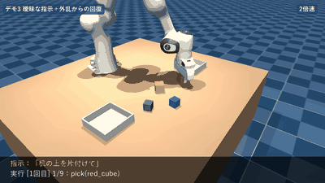
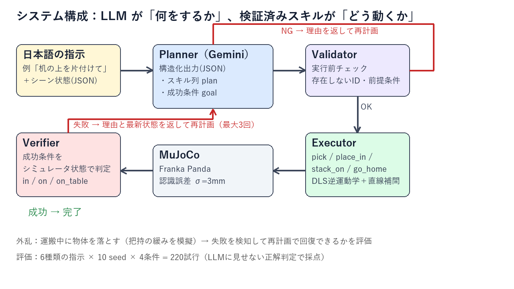
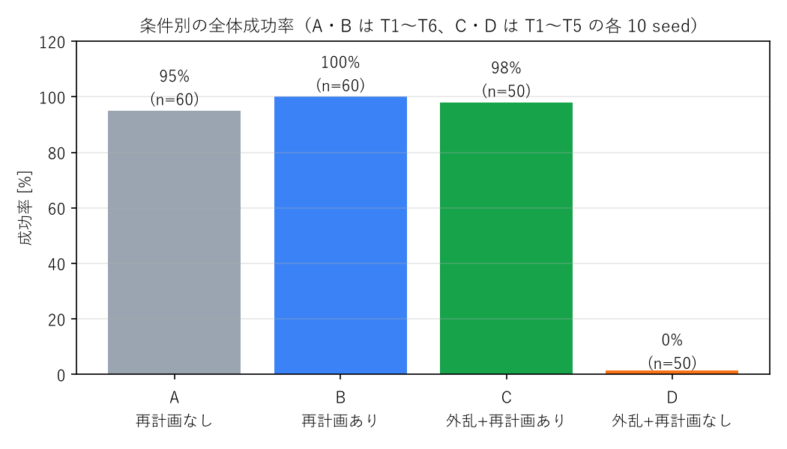

# 言語指示で片付けるロボットアーム
**Gemini（LLM）× MuJoCo Franka Panda — 計画・検証・再計画の閉ループでタスクを実行する**

Physical AI 応用編1（2026）最終課題 ／ 作成：Martingale



「机の上を片付けて」「青以外のブロックを左の箱に」「大きい順に積み上げて」といった日本語の指示を受け取り、
LLM（Gemini）が **スキル列と成功条件** を生成し、検証済みのスキルでロボットアームが実行します。
運搬中に物体を落とす外乱を入れても、**失敗理由を LLM に返して再計画することで 98% 回復** します（再計画なしでは 0%）。

## 特徴
- **役割分担**：LLM は「何をするか（What）」だけを決め、「どう動くか（How）」は検証済みスキル（IK＋直線補間）が担う
- **二重の検証**：実行前の Validator（存在しない ID・前提条件の違反）と、実行後の Verifier（成功条件をシミュレータ状態で判定）
- **閉ループ再計画**：失敗理由（例 `dropped_during_transport: red_cube`）と最新状態を返し、残りの作業だけを計画し直す（最大 3 回）
- **自前の逆運動学**：減衰最小二乗法（DLS）＋最小躍度補間で、手先を直線的に動かす
- **再現可能な評価**：seed 固定 × 4 条件 × 220 試行を、LLM に見せない正解判定で採点



## 評価結果（220 試行、`gemini-3.5-flash`）

| 条件 | 成功率 | 試行数 |
|---|---|---|
| A 再計画なし | 95% | 60 |
| B 再計画あり | 100% | 60 |
| C 外乱＋再計画あり | **98%** | 50 |
| D 外乱＋再計画なし | 0% | 50 |



失敗はすべて「積み上げ（T4）」の物理層（置いた後のずれ・落下）で、LLM の計画ミスや Validator での却下は 0 件でした。
詳細・考察・限界は [docs/04_results.md](docs/04_results.md) を参照してください。

## ディレクトリ構成
```
src/
  sim.py        シーン生成（MjSpec）・状態取得・外乱・録画
  ik.py         減衰最小二乗（DLS）逆運動学・最小躍度補間
  skills.py     pick / place_in / stack_on / go_home（失敗理由つき）
  planner.py    Gemini 呼び出し（構造化出力・トークン計測・リトライ）
  validator.py  実行前の記号的な計画チェック
  verifier.py   述語 in / on / on_table / holding の判定
  tasks.py      評価用の指示 T1〜T6 と正解判定
  run.py        1 指示を実行（計画→検証→実行→判定→再計画）
  video.py      字幕の焼き込み・動画編集
eval/evaluate.py  一括評価（中断・再開可）と集計・グラフ
scripts/make_video.py  提出用動画の作成
docs/            設計書・実装計画・参考文献・評価結果
assets/          Franka Panda モデル（mujoco_menagerie, Apache-2.0）
```

## セットアップ
Python 3.13（Windows 11 で動作確認）。GPU は不要です。

```bash
python -m venv .venv
.venv\Scripts\activate            # macOS / Linux: source .venv/bin/activate
pip install -r requirements.txt
```

Gemini API キーを [Google AI Studio](https://aistudio.google.com/apikey) で発行し、リポジトリ直下に `.env` を作成します（`.gitignore` 済み）。
```
GEMINI_API_KEY=your-key
# 任意: GEMINI_MODEL=gemini-3.5-flash
```

## 使い方
```bash
# LLM なしでスキルだけ確認（手書きの計画を 10 seed で実行）
python -m src.skills --trials 10

# 指示を 1 つ実行（--record で字幕付き動画を outputs/ に保存）
python -m src.run --task T5 --seed 1 --disturb --record --speed 2
python -m src.run --instruction "緑のブロックを黄色の上に積んで" --seed 3

# 一括評価（中断しても再実行で続きから）と集計
python -m eval.evaluate --seeds 10
python -m eval.evaluate --report
```

| タスク | 指示 | ねらい |
|---|---|---|
| T1 | 赤いブロックを左の箱に入れて | 単純な移動 |
| T2 | 小さいブロックを全部右の箱に入れて | 属性による選択 |
| T3 | 青以外のブロックを左の箱に入れて | 否定 |
| T4 | ブロックを大きい順に下から3段積み上げて | 順序と精密な配置 |
| T5 | 机の上を片付けて | 曖昧な指示の解釈 |
| T6 | 紫のブロックを左の箱に入れて | 実行不能な指示の拒否 |

## ドキュメント
- [設計書](docs/01_design.md) ／ [実装計画書](docs/02_implementation_plan.md) ／ [参考文献](docs/03_references.md) ／ [評価結果と考察](docs/04_results.md)

## ライセンスと出典
- Franka Emika Panda モデル：[google-deepmind/mujoco_menagerie](https://github.com/google-deepmind/mujoco_menagerie)（Apache-2.0）。出典は [assets/SOURCE.md](assets/SOURCE.md)
- 設計の背景：SayCan、Inner Monologue、Code as Policies ほか（[参考文献](docs/03_references.md)）
- 本リポジトリには講座の資料・配布素材は含めていません
