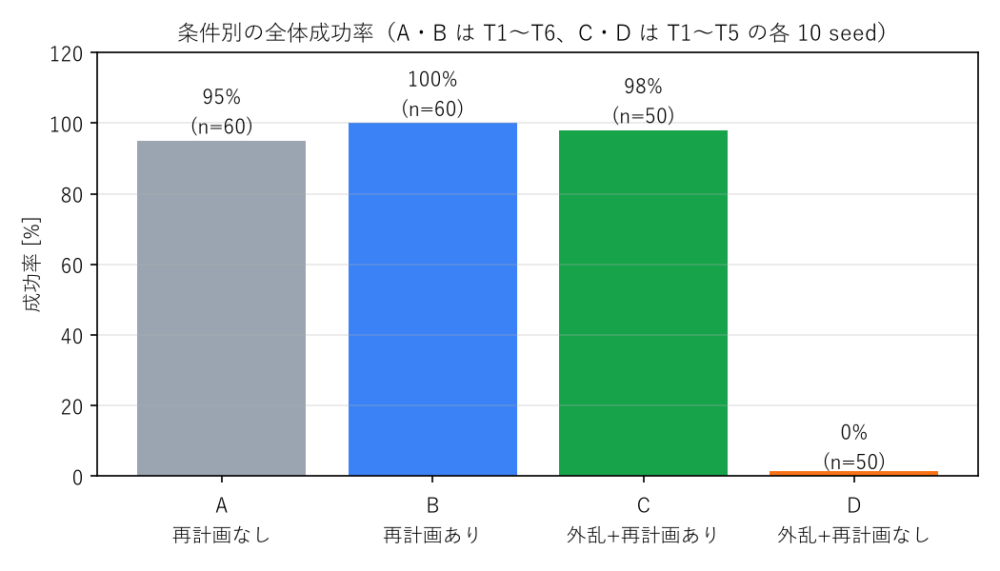
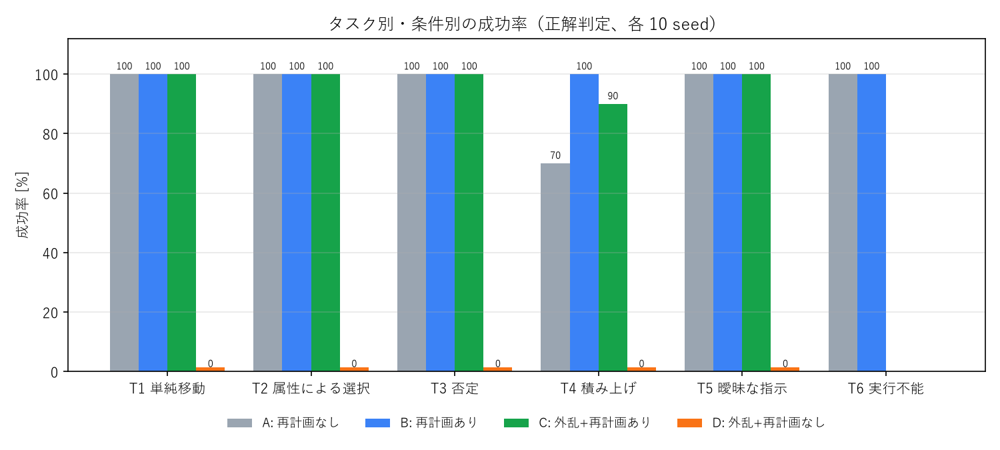

# 評価結果と考察

- 実施日：2026/10/31　モデル：`gemini-3.5-flash`（temperature=0、構造化出力）
- 試行数：220（6 タスク × 10 seed × 条件 A/B、T1〜T5 × 10 seed × 条件 C/D）
- 生データ：[results/results.jsonl](results/results.jsonl)（1 試行 1 行）／集計：[results/summary.md](results/summary.md)
- 再現：`python -m eval.evaluate --seeds 10`（中断しても再実行で続きから）→ `python -m eval.evaluate --report`

## 1. 実験条件

| 条件 | 再計画 | 外乱 | 何を見るか |
|---|---|---|---|
| A | なし（1 回だけ計画） | なし | LLM＋スキルの「一発勝負」の性能 |
| B | あり（最大 3 回） | なし | 再計画で偶発的な失敗をどこまで救えるか |
| C | あり（最大 3 回） | あり | 外乱から回復できるか |
| D | なし | あり | 外乱の影響の大きさ（C の比較対象） |

外乱：最初の運搬（place_in / stack_on）の途中でグリッパを一瞬開き、物体を落とす（把持の緩みの模擬）。
成功判定：LLM には見せない「正解判定」（[src/tasks.py](../src/tasks.py)）。LLM 自身の成功条件とは独立。

## 2. 結果

| 条件 | 成功率 | 試行数 | LLM 呼び出し/試行 | LLM 応答時間/試行 | 入力 / 出力 / 思考トークン |
|---|---|---|---|---|---|
| A 再計画なし | **95%** | 60 | 1.00 | 5.6 s | 805 / 192 / 413 |
| B 再計画あり | **100%** | 60 | 1.03 | 5.8 s | 837 / 203 / 472 |
| C 外乱＋再計画あり | **98%** | 50 | 2.04 | 10.8 s | 1823 / 491 / 1091 |
| D 外乱＋再計画なし | **0%** | 50 | 1.00 | 4.9 s | 805 / 231 / 494 |

- 合計：LLM 呼び出し 274 回、入力 23.0 万 / 出力 6.0 万 / 思考 13.2 万トークン
- 実費は AI Studio の Spend ページで確認する（反映に数時間かかる）

## 3. 考察

### 3.1 外乱からの回復：再計画で 0% → 98%
- 物体を落とすと、再計画なし（D）では **全試行が失敗**、再計画あり（C）では **49/50 が回復**した。
- 回復時、Gemini は失敗理由（例：`dropped_during_transport: red_cube`）と最新の状態を受け取り、
  **落ちた物体から順に、残りの作業だけ**を計画し直していた。
- 追加コストは LLM 呼び出し 1 回分（応答時間 +5 秒程度）。

### 3.2 失敗はすべて「積み上げ（T4）」の物理層で起きた
- A の失敗 3 件、C の失敗 1 件はすべて T4。**LLM の計画はすべて妥当**（大→大→小の順）で、Validator で弾かれた計画は 0 件。
- 失敗原因は `stack_failed`（置いた後に塔から落ちた・ずれた）と、落下後に傾いた物体の `grasp_failed`。
  - 大（5cm）の上に大（5cm）を置くと縁の余裕がなく、認識誤差（σ=3mm）と置く位置のずれで落ちやすい。
- B では、この偶発的な失敗も 2 回目の計画で回復し 100% になった（A 70% → B 100%）。
- **教訓**：失敗を層別に記録したことで、「LLM を賢くする」より「スキル（置く精度）を改善する」方が効くと判断できる
  （第 7 回の「データ / 学習 / 推論 / 制御 の層で切り分ける」の実践）。

### 3.3 LLM の自己判定と正解判定の食い違い：0 件
- LLM が「成功条件を満たした」と判断した試行で、正解判定が失敗だったものは 0 件。
- 一方、A の T4 seed=8 では LLM の成功条件が未達（`on(yellow_cube, red_cube)`）と **Verifier が正しく検出**した。
  再計画なしなので失敗のまま終わったが、B では同じ状況から回復している。

### 3.4 曖昧な指示・実行不能な指示
- T5「机の上を片付けて」：全条件で成功。ただし解釈は seed により「全部左の箱」「近い方の箱へ振り分け」と揺れた。
  どちらも正解判定では成功だが、**ユーザが望む解釈だったかは測れていない**。
- T6「紫のブロック」：20/20 で実行不能と判断し、ロボットを動かさなかった。

## 4. この評価で測れていないこと（限界）
- **認識**：物体の位置はシミュレータの真値＋ガウスノイズ。カメラ画像からの認識は含まない。
- **実機**：摩擦・把持・センサ遅延などの sim2real ギャップは未評価。
- **外乱の種類**：「運搬中に落とす」1 種類・1 回のみ。人が物を動かす、複数回の外乱などは未評価。
- **指示の多様性**：6 種類の固定文。言い換え・長い指示・複数の物体の位置関係（「赤の右の青」など）は未評価。
- **統計**：各セル 10 試行。T4 の差（70% vs 100%）は小さい試行数での結果であり、信頼区間は広い。
- **D の 0%**：外乱を必ず入れるため、再計画なしでは原理的に失敗する設計。D は「外乱が確実に効いている」ことの確認であり、
  C との差は「再計画の効果の上限」を示すもの。

## 5. 反省点・試行錯誤の記録
- 無料枠の `gemini-2.5-flash` は新規ユーザに提供終了、`gemini-3.8-flash` は無料枠で応答に約 160 秒かかり実用外だった。
  → 無料枠で約 8 秒の `gemini-3.5-flash` を採用。
- 無料枠は「1 モデル 1 日 20 リクエスト」で、評価（274 回）には足りなかった → Prepay に切り替え。
- 当初の評価スクリプトは、API 上限エラーで止まった試行を「失敗」として成功率に含めてしまっていた。
  → API エラーの試行は記録せず中断・再開する方式に修正（「何の失敗か」を混ぜない）。
